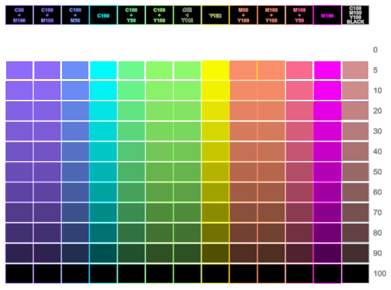

# Lithop

Create backlit color lithophanes locally.

Lithop is a local CMYW color lithophane generator with a CLI and browser UI. By default, it turns a JPEG, PNG, or validated self-contained SVG image into a single-plate multipart CMYW 3MF and a White reference STL; optional XY tiling and Z-separated plates are also available. The source image is processed without uploading it or copying it into the completed output job.



*CMYW lithophane preview generated from the bundled color chart. This is the pre-print preview, not a photograph of a physical print.*

## Status and safety

The standard profile uses:

| Setting | Standard value |
| --- | --- |
| Model size | 140 × 104 mm |
| Thickness grid | 637 × 473 cells, approximately 0.22 mm per cell |
| Nozzle | 0.2 mm |
| White base | One 0.10 mm first layer |
| Color region | Seven 0.08 mm CMYW layers; default `Yellow -> Magenta -> Cyan -> White` order |
| Upper White | Continuous White from 0.66 mm, sliced at 0.08 mm; one layer at the 0.74 mm brightest thickness |
| Extruders | Cyan=1, Magenta=2, Yellow=3, White=4 |

Bambu Studio restores the generated single `lithophane` plate and its White/Cyan/Magenta/Yellow assignments. The bundled fine-line target and 140 × 104 mm color chart have been physically printed with the current 0.2 mm, seven-layer standard. LED transmission was visually checked on the chart and showed stronger transmission at Y100; the recipes and White thickness stages have not been measured numerically. Colorimetric accuracy is not guaranteed.

Before printing, inspect every layer and confirm the Cyan, Magenta, Yellow, and White assignments. Do not move, align, scale, or merge individual material parts. Lithop does not slice models, send print jobs, or control a printer or AMS.

## Requirements

- macOS, Ruby 4.0 or later, and Rust. CI verifies macOS with Ruby 4.0; the current measured build is Apple silicon.
- libvips with JPEG, PNG, SVG (librsvg), and ICC profile support
- For physical printing: Bambu Studio, an AMS-capable printer, and the required PLA Basic Cyan, Magenta, Yellow, and White filaments

## Install

To install Lithop 0.4.0 from RubyGems, install libvips, Rust for the native palette extension, and the matching Lithop version:

```sh
brew install vips rust
gem install lithop -v 0.4.0
lithop --version
lithop doctor
```

The version command must print `0.4.0`.
The doctor command reports `"backend": "rust"` and the loaded native-extension version. Set
`LITHOP_DISABLE_NATIVE=1` only when comparing the Ruby fallback.

To work from a source checkout instead:

```sh
bin/setup
bundle exec lithop --version
```

## Quick start

With an installed gem, generate a model from one JPEG, PNG, or SVG:

```sh
lithop path/to/image.png
```

From a source checkout, use the bundled sample and a coarse cell size for a faster first run:

```sh
bundle exec lithop examples/cmy-fine-line.svg --width 20 --height 15 --pixel-size 0.5
```

To use the local browser UI, start its loopback-only server and open the displayed URL:

```sh
lithop ui
```

The UI keeps Create, Jobs, and Presets in a persistent top navigation. The Create view places the conversion action next to drag-and-drop image selection and provides section navigation for grouped settings; the Presets view separates saved-setting selection from save and management operations. Responsive panes, an engine-rendered input preview, persistent job progress and cancellation, side-by-side result views, and per-job artifact management remain available. Sinatra, ERB, Puma, CSS, and JavaScript are included in the gem, so the workflow remains local and works offline after installation. Playwright is used only for source-checkout browser tests. See [local browser UI](docs/local-ui.md).

The standard command generates the 140 × 104 × 1.94 mm, 0.2 mm-nozzle layout:

```sh
bundle exec lithop path/to/image.jpeg
```

It writes `lithop.3mf` with a single `lithophane` plate and White/Cyan/Magenta/Yellow extruders. Its layer preview and physical print still require manual verification.

Use `--brightness`, `--contrast`, and `--saturation` with percentages from `-100` to `100` to adjust the shared sRGB input before White thickness and CMYW recipes are sampled. The resolved values are recorded in each job's `settings.json`.

Use `--yellow-mix-color cyan|magenta` with `--yellow-mix-percent 0..100` to replace that percentage of Yellow coverage before the nearest layered recipe is selected. The default is 0%, so existing output is unchanged. Seven-layer output quantizes the requested ratio to whole layers.

Use `--tile-count N` with `--tile-layout auto`, `columns`, `rows`, or `grid` to emit exactly N local-origin 3MF tiles. Tiled jobs include assembled offsets and bounds in `manifest.json` plus a physical-size `tile-layout.svg` placement guide.

Add `--separate-z-parts` to slice the CMYW model into 1–3 contiguous Bambu Studio plates. Every plate receives Base White support beneath its source Z slice so Cyan and Yellow regions remain connected after printing. Z separation uses eight 0.08 mm CMY/W color layers. `--color-region-parts 3` uses equal source ranges beginning at 0.10, 0.42, and 0.74 mm. The second plate ends with the color region, while the third contains no CMY. To prevent its brightest area from becoming a fragile two-layer sheet, Z plate 3 uses three Base White layers (0.26 mm) plus at least one 0.08 mm Top White layer. Its printed minimum is 0.34 mm, and the assembled range is 1.18–2.30 mm. See [3MF tiling and Z separation](docs/tiling.md).

The command reports estimated and final triangle counts and creates a new `build/<job_id>/` directory. Completed jobs are never overwritten. Inspect `preview.png`, `transmission.png`, `thickness.png`, and the four material masks, then import `lithop.3mf` into Bambu Studio as a model. The 3MF contains geometry, fixed extruder numbers, and layer-height metadata. It does not select a printer, physical build plate, AMS slot, or complete slicing preset.

The bundled color chart at standard settings produces 2,660,706 CMYW 3MF triangles, below the default 5,000,000-triangle limit. Runtime and memory depend on the image and machine; use a smaller model and a coarser cell size for initial checks.

See [installation and basic use](docs/getting-started.md), the [artifact reference](docs/artifacts.md), and the [Bambu Studio checklist](docs/bambu-studio.md) before printing.

## Input and settings

JPEG and PNG input supports EXIF orientation, transparency composited over White, and embedded ICC conversion to sRGB. SVG input is rendered in memory through librsvg and must be an uncompressed, static, self-contained document no larger than 15,000,000 bytes. External files, network URLs, data URLs, external CSS, DTDs, scripts, animation, and `foreignObject` are rejected.

Settings resolve in `command line > JSON file > built-in defaults` order. A project can keep reusable overrides in `config/settings.json`:

```json
{
  "layout_profile": "standard",
  "width": 140.0,
  "height": 104.0
}
```

The command-line options can override individual profile values. Use `--color-pixel-size` to make CMYW recipe cells coarser than the White thickness grid, and `--image-fit`, crop, and margin options to control placement. See [options and settings](docs/config.md) for the complete input schema and validation rules.

## Other commands

- `lithop calibrate` creates a 140 × 104 mm calibration SVG and matching printable 3MF with all 120 seven-layer recipes, eight White thickness stages, and a measurement-profile template. A completed measured profile can select both color recipes and the physical White height used by the 3MF, STL, previews, thickness map, and material masks. See [color calibration](docs/calibration.md).
- `lithop ui` starts the local browser UI on `127.0.0.1:4567`; on macOS, completed 3MF artifacts can be handed directly to Bambu Studio from the Jobs view. See [local browser UI](docs/local-ui.md).
- `lithop doctor` reports whether the Rust acceleration extension is loaded, enabled, and version-matched.
- `lithop clean` permanently removes the selected project's complete `build/` directory, not one job. See the [command reference](docs/command.md#生成物を削除する) before using it.
- `lithop --help`, `lithop calibrate --help`, `lithop ui --help`, and `lithop clean --help` show the current command syntax.

## Documentation

- [Documentation index and verification status](docs/README.md)
- [Installation and basic use](docs/getting-started.md)
- [Local browser UI](docs/local-ui.md)
- [Bambu Studio verification and printing](docs/bambu-studio.md)
- [Options and settings](docs/config.md)
- [Artifacts and generation records](docs/artifacts.md)
- [3MF tiling and Z separation](docs/tiling.md)
- [CMYW color model and layer structure](docs/color-model.md)
- [Optional measured calibration](docs/calibration.md)
- [Command reference](docs/command.md)
- [Troubleshooting](docs/troubleshooting.md)

## Ruby API and development

The RubyGem and CLI command are named `lithop`; the Ruby namespace is `Lithop`. Supported public signatures are declared in [`sig/lithop.rbs`](sig/lithop.rbs). Helper classes under `lib/lithop/export/`, `lib/lithop/cli/`, and `lib/lithop/formats/three_mf/` are internal unless listed there.

```sh
bin/setup
bundle exec rake
bundle exec rbs validate
```

Before publishing, run `bundle exec rake release:check` and follow [RELEASING.md](RELEASING.md).

## License

[MIT](LICENSE)
